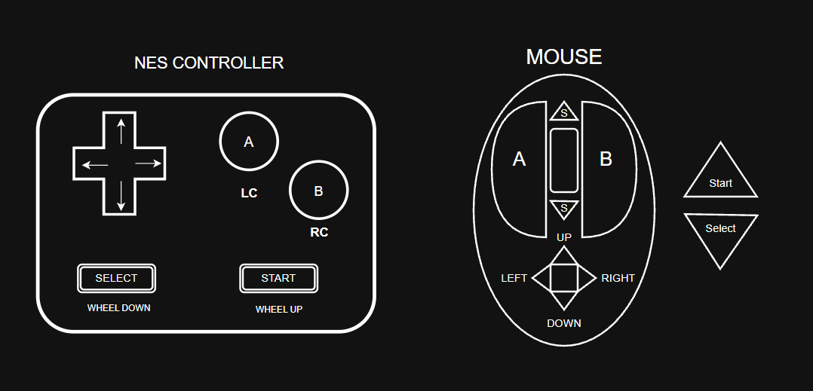
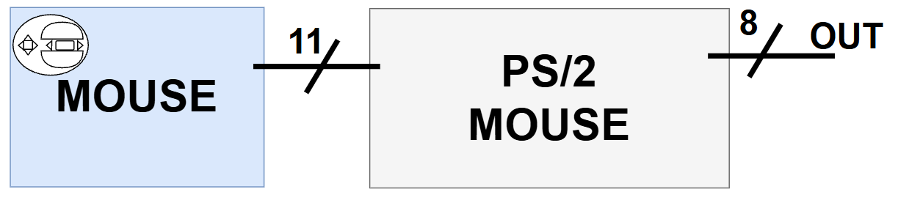
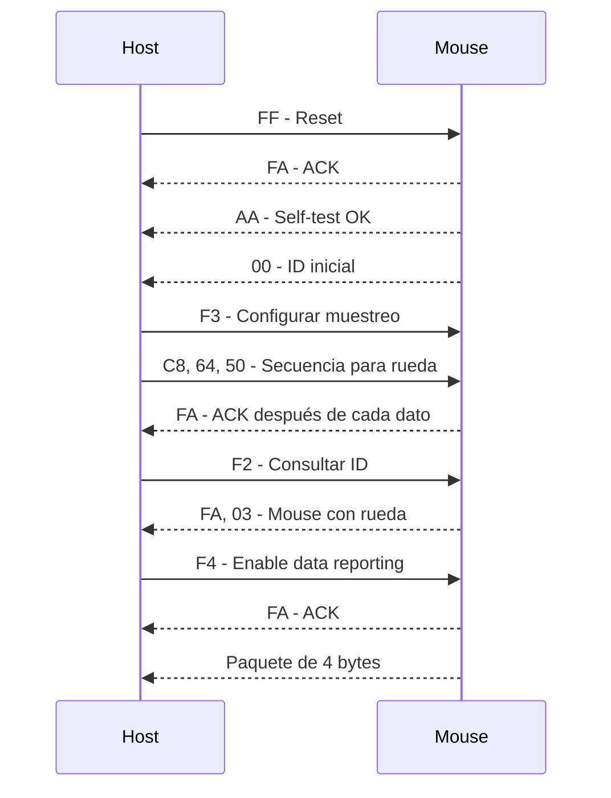

#  Interfaz de Mouse PS/2

##  Descripción

Este proyecto implementa la comunicación entre un mouse y un sistema anfitrión utilizando el protocolo **PS/2**.

El objetivo es utilizar un mouse PS/2 como periférico de entrada para una consola de videojuegos, interpretando los datos enviados por el mouse para obtener información sobre el movimiento y el estado de sus botones.


##  Control de la consola





##  Conexiones

La comunicación PS/2 utiliza dos señales principales:

- **Clock:** señal de reloj.
- **Data:** transmisión de datos de 12 bits.



El protocolo permite comunicación bidireccional, por lo que el sistema anfitrión también puede enviar comandos al mouse.

---

##  Funcionamiento en Mouse

El mouse PS/2 utiliza una comunicación serial síncrona entre el dispositivo y el sistema anfitrión.

Cuando el ratón PS2 envía información, debe enviar tres paquetes de datos consecutivos. Cada paquete contiene información diferente sobre el botón pulsado, el movimiento y la dirección del mismo.

Al encenderse, el mouse realiza un proceso de autodiagnóstico denominado **BAT (Basic Assurance Test)**.

Si el diagnóstico es exitoso, el mouse envía un código de confirmacion:

```text
0xAA
```

Posteriormente envía su identificador:

```text
0x000
```

El identificador `0x00` corresponde al mouse PS/2 estándar.

---


## Detalles del Microsoft IntelliMouse

El mouse a utilizar necesita un procedimiento de setup para llegar a un modo de Microsoft IntelliMouse, el cual proporciona información sobre:

<table>
  <thead>
    <tr>
      <th></th>
      <th>Bit 7</th>
      <th>Bit 6</th>
      <th>Bit 5</th>
      <th>Bit 4</th>
      <th>Bit 3</th>
      <th>Bit 2</th>
      <th>Bit 1</th>
      <th>Bit 0</th>
    </tr>
  </thead>
  <tbody>
    <tr>
      <td><b>Byte 1</b></td>
      <td>Y overflow</td>
      <td>X overflow</td>
      <td>Y sign bit</td>
      <td>X sign bit</td>
      <td>Always 1</td>
      <td>Middle Btn</td>
      <td>Right Btn</td>
      <td>Left Btn</td>
    </tr>
    <tr>
      <td><b>Byte 2</b></td>
      <td colspan="8" align="center">X Movement</td>
    </tr>
    <tr>
      <td><b>Byte 3</b></td>
      <td colspan="8" align="center">Y Movement</td>
    </tr>
    <tr>
      <td><b>Byte 4</b></td>
      <td colspan="8" align="center">Z Movement</td>
    </tr>
  </tbody>
</table>

##  Interpretación de los datos

El primer byte permite determinar el estado de los botones y el signo del movimiento.

El rango de movimiento representable para X y Y es:

```text
-255 a +255
```
El cuarto byte representa el movimiento de la rueda mediante un valor de **4 bits en complemento a dos**.

```text
Bit 7|6|5|4 → Extensión de signo
Bit 3    ---→ Z3
Bit 2    ---→ Z2
Bit 1    ---→ Z1
Bit 0    ---→ Z0
```
El un rango de

```text
-8 a +7
```

El envió y recepción de datos tienen la siguiente forma de onda:


---

## Secuencia de inicialización del mouse PS/2 Microsoft IntelliMouse

Para activar el modo Microsoft IntelliMouse se debe seguir la siguiente secuencia:




### Descripción de la secuencia

- **FF – Reset:** reinicia el mouse.
- **FA – ACK:** confirma la recepción y aceptación de un comando.
- **AA – Self-test OK:** indica que el autotest terminó correctamente.
- **00 – ID inicial:** identifica el dispositivo antes de configurar el modo de rueda.
- **F3 – Configurar muestreo:** permite enviar la secuencia especial de velocidades `200 (F3 C8), 100 (F3 64), 80 (F3 50)` para activar el modo IntelliMouse.
- **F2 – Consultar ID:** permite verificar el modo de funcionamiento; `0x03` identifica el modo con rueda.
- **F4 – Enable data reporting:** habilita el envío automático de datos.
- **Paquete de 4 bytes:** contiene el estado de los tres botones, los desplazamientos X/Y y el movimiento de la rueda.


## Conexiones fisicas del dispositivo

El ps/2 del mouse consta de un conector de 5 o 6 pines (dependiendo del dispositivo), los cuales asignan 4 pines en ambos casos, y es posible usar un adaptador de uno a otro, o lograr usar algún pin para otro proposito.


##  Modos de operación

El protocolo PS/2 contempla diferentes modos de funcionamiento:

### Reset Mode
---
Se utiliza durante el encendido del mouse o cuando recibe el comando:

```text
0xFF
```

El mouse realiza el diagnóstico BAT y restablece sus parámetros.

### Stream Mode
---
Es el modo utilizado normalmente.

El mouse transmite información cuando detecta:

- Movimiento.
- Cambio en el estado de un botón.

### Wrap Mode
---
Es un modo utilizado principalmente para comprobar la comunicación entre el mouse y el sistema anfitrión.


##  Comandos principales para el host

| Comando | Función |
|--------:|---------|
| `0xFF` | Reset |
| `0xFE` | Resend |
| `0xF6` | Restaurar valores predeterminados |
| `0xF5` | Deshabilitar transmisión de datos |
| `0xF4` | Habilitar transmisión de datos |
| `0xF3` | Configurar frecuencia de muestreo |
| `0xF2` | Obtener ID del dispositivo |
| `0xF0` | Activar Remote Mode |
| `0xEE` | Activar Wrap Mode |
| `0xEC` | Salir de Wrap Mode |
| `0xE8` | Configurar resolución |
| `0xE7` | Escalamiento 2:1 |
| `0xE6` | Escalamiento 1:1 |


##  Códigos principales del mouse


##  Aplicación en el proyecto

En este proyecto, el sistema debe:

1. Inicializar la interfaz PS/2.
2. Esperar la respuesta de inicialización del mouse.
3. Detectar el paquete de datos.
4. Recibir los cuatro bytes del paquete.
5. Verificar los bits de control.
6. Extraer los valores de X, Y y Z.
7. Detectar el estado de los botones.
8. Convertir estos datos como entradas para la consola.


---


##  Referencias

- Adam Chapweske, **PS/2 Mouse Interfacing**  
  https://isdaman.com/alsos/hardware/mouse/ps2interface.htm

- PS/2 Mouse Protocol  
  https://wiki.osdev.org/PS/2_Mouse

---

##  Integrantes

1. Daniel Gustavo Arango Yela
2. Juan Sebastián Rincon Aguilera
3. David Fernando Fúquene Alvarez

---
